# LiveWorkbench 核心功能开发文档：架构、数据流与开发规范

版本：1.3（按用户调整为能力提取与工程交付；首个源码增量见进度台账）
初版日期：2026-10-09；修订日期：2026-10-12  
适用范围：主播本人使用的本地直播工作台；偶尔人工选择其他直播间测试。  
阅读方式：第一部分为 Mermaid 人看版；第二部分为 AI／开发者规格版。

**唯一权威位置：`docs/architecture/CORE_DEVELOPMENT.md`。** 经用户确认，将本对话初版迁入 `C:/project/LiveWorkBench`；原输出位置仅保留跳转入口，不维护第二套正文。

配套权威文档：[内部数据契约](../contracts/CORE_CONTRACTS.md)、[公共 API](../contracts/PUBLIC_API.md)、[源码审计与迁移](../migration/SOURCE_MIGRATION.md)、[真实进度与交接](../progress/STATUS.md)、[决策记录](../decisions/DECISION_LOG.md)。AI 开发规范见 [AGENTS.md](../../AGENTS.md)。

## 文档口径与依据

本文件依据引用对话《调整功能层级》中的用户陈述，以及上传的《直播工作台功能层级目录.md》《需求依据与待确认项.md》《README.md》整理。对话已沿分页读取到最早一轮；历史助手正文在读取结果中只显示内容引用标记，不能据此声称读到了其完整方案。本文件以可读取的用户原话和附件正文为依据。

初版依据上传的策划 README；本次进一步核对本地三个参考仓库的提交、相关源码片段及 Bark/ntfy 文档。主仓库修订前只有 `.gitignore` 与 `references/`，未有核心实现。静态证据与差异集中记录在源码迁移文档；未编译、未启动参考程序、未捕获或回放真实 RAW，不能宣称已通过运行基线。启动顺序继续按已确认使用体验作为开发前提。

全文使用三种标记：

- **[已确认]**：用户明确陈述的约束，或本次明确要求覆盖的范围。
- **[规格建议]**：为使已确认约束可实现而提出的接口、状态与保护规则；尚不等同于用户逐条冻结的实现方案。
- **[待定]**：证据或业务参数不足，实施相应模块前需要明确。待定项不得被 AI 自行写成已确认规则。

第二部分中的“必须／不得”表达目标规格的强度：已确认条目必须遵守；规格建议中的强制语句表示采用该建议方案时需要共同成立的约束。历史文件中的“已有基础”“历史需求”“后续扩展”继续表示来源或成熟度，不表示本项目已经实现。

---

# 第一部分：简明人类阅读版（Mermaid 图解）

图中“已确认”是当前约束；“规格建议”是目标设计；“待定”表示尚未冻结。详细字段、条件与例外见第二部分。

## A1. 项目范围与核心约束

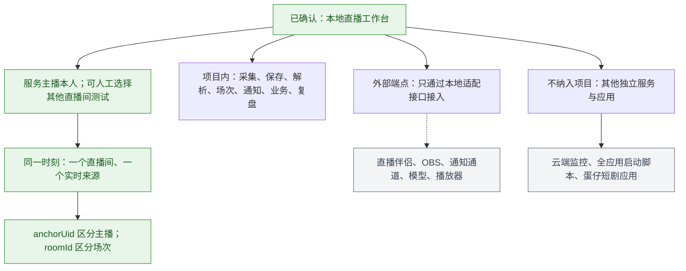

## A2. 产品功能层级

沿用上传目录的导航；以下是功能归属，不是已实现清单。

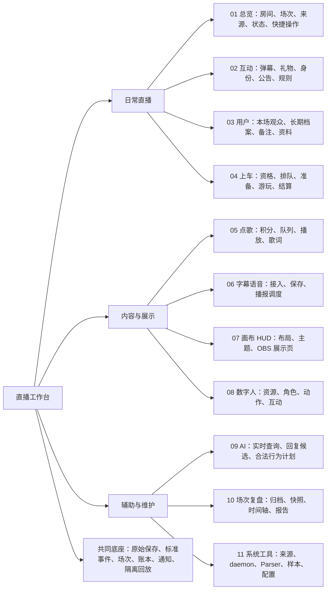

## A3. 数据从采集到业务

以下流水线为规格建议；原始保存与业务过滤分开。

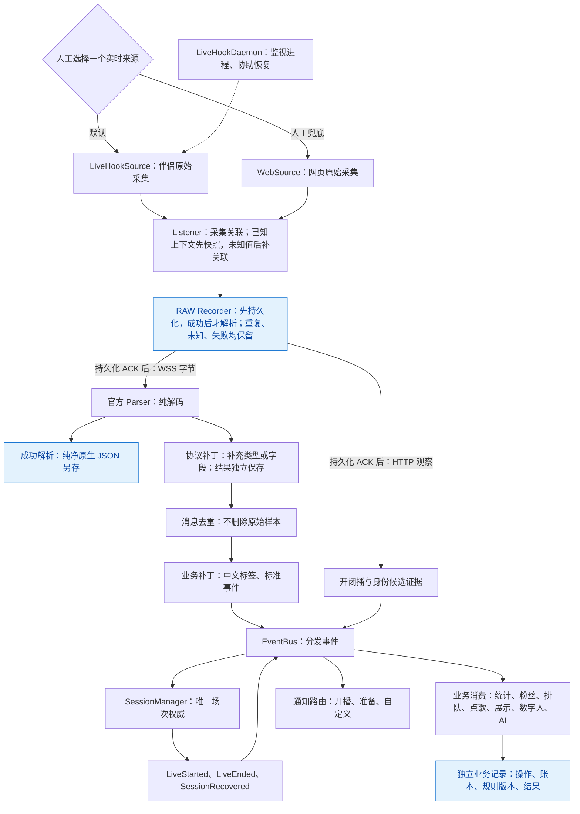

## A4. 人工热切换与本地监控

来源选择及监控启停已确认；切换事务是规格建议。

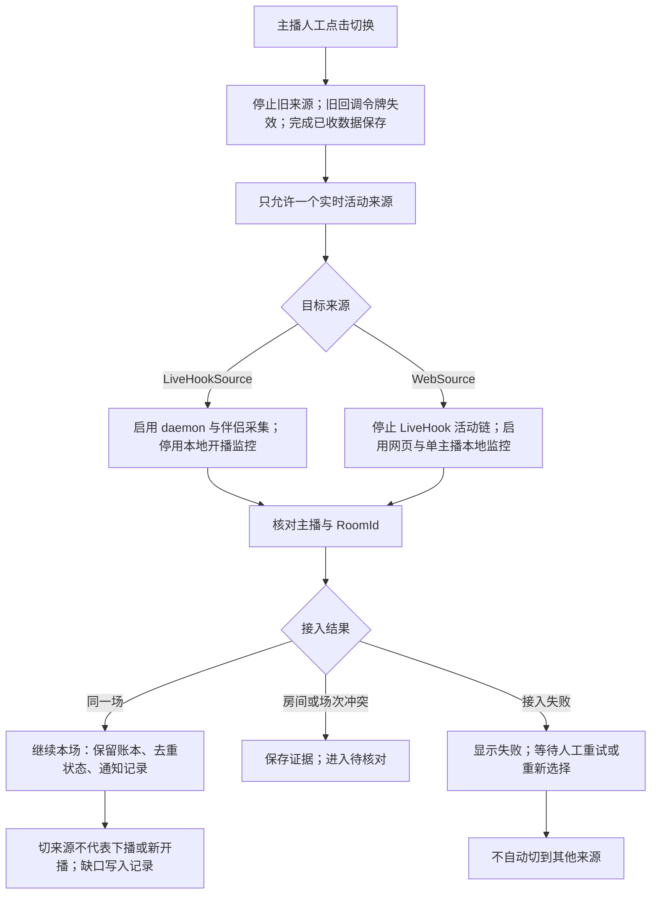

## A5. 启动顺序与进程恢复

先捕获就绪、后启动／重启伴侣，是按用户使用体验确认的开发前提。

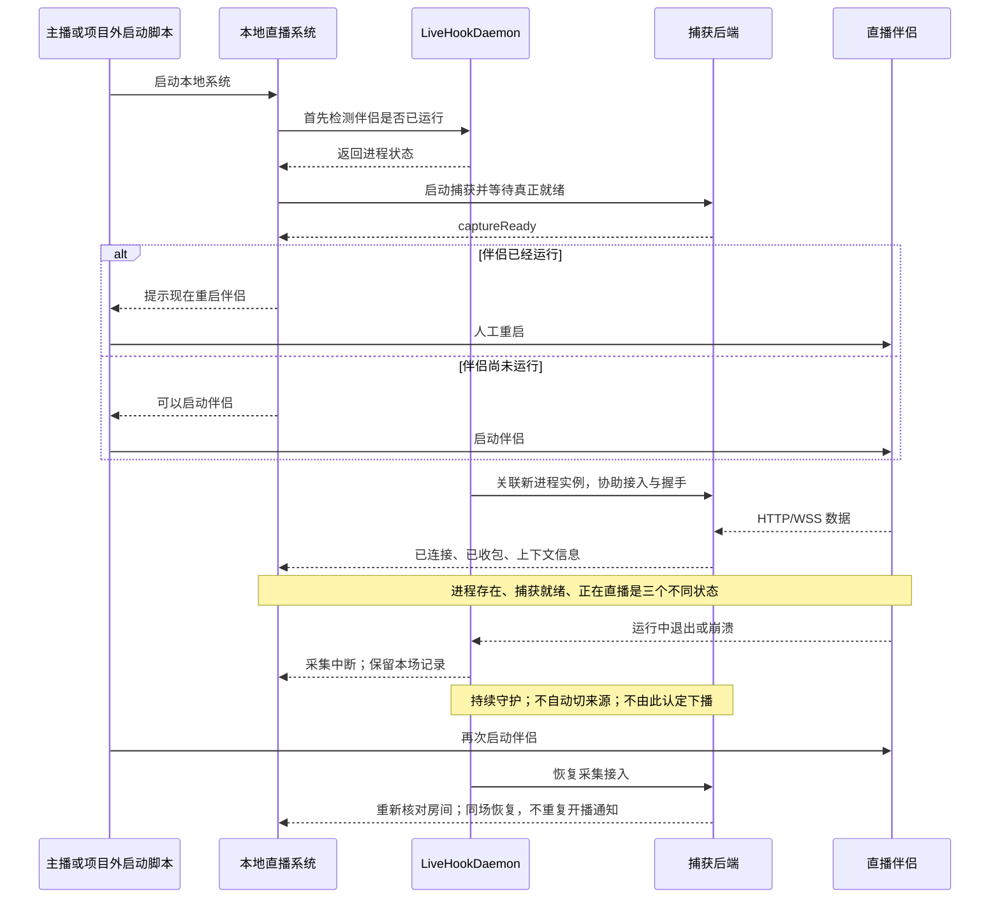

## A6. 哪些信号才算开闭播

以下为规格建议；HTTP 校验细节和异常新场策略仍需样本／规则收敛。

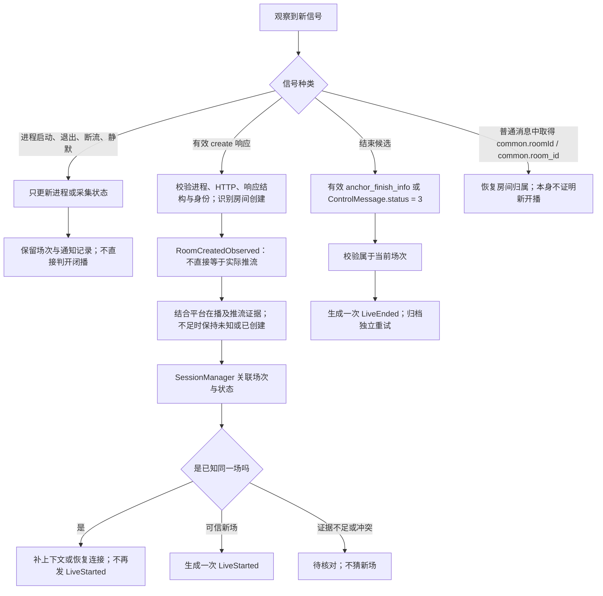

## A7. 通知如何分发与避免重复

多业务、多通道路由是已确认目标；持久化意图和发送任务是规格建议。

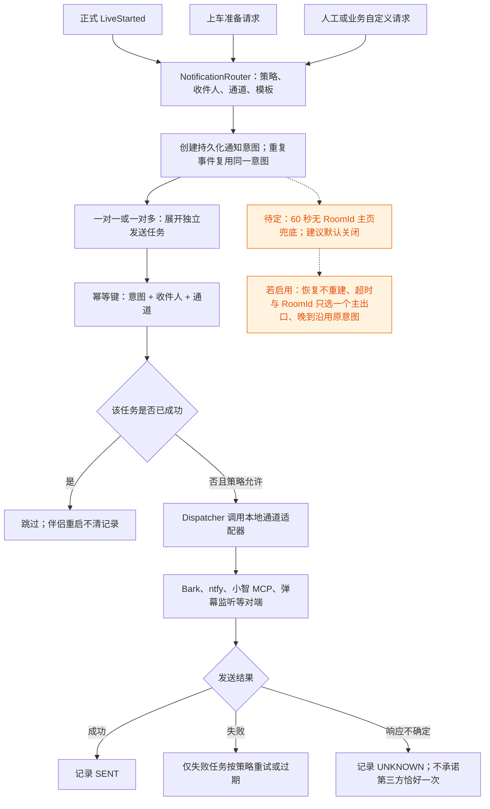

## A8. 保存、归档与隔离 Replay

保存与回放目标已确认；目录、引用和隔离装配为规格建议。

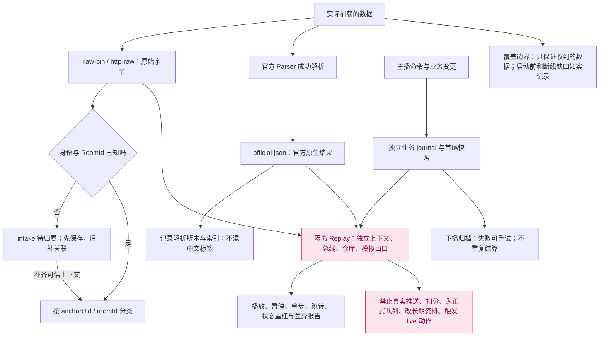

## A9. 故障边界与待定项

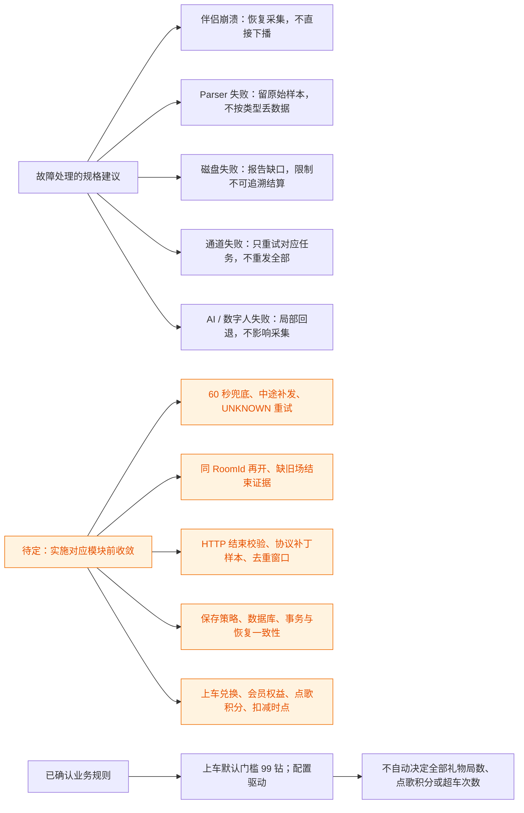

---

## A10. 开发策略：提取成熟能力并持续交付

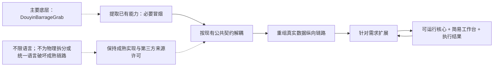

## A11. 多设备前端与 P0 公共能力

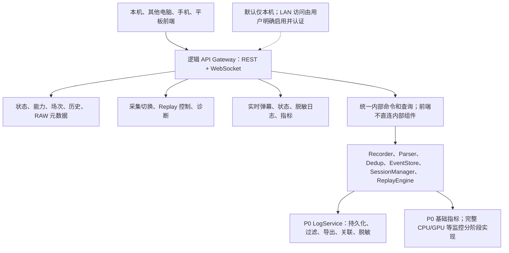

## A12. 实时弹幕无限回滚

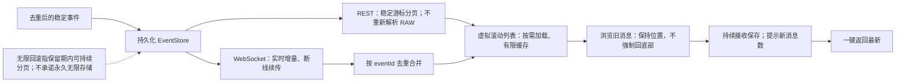

---

## A13. 边开发边测试：简易验证工作台

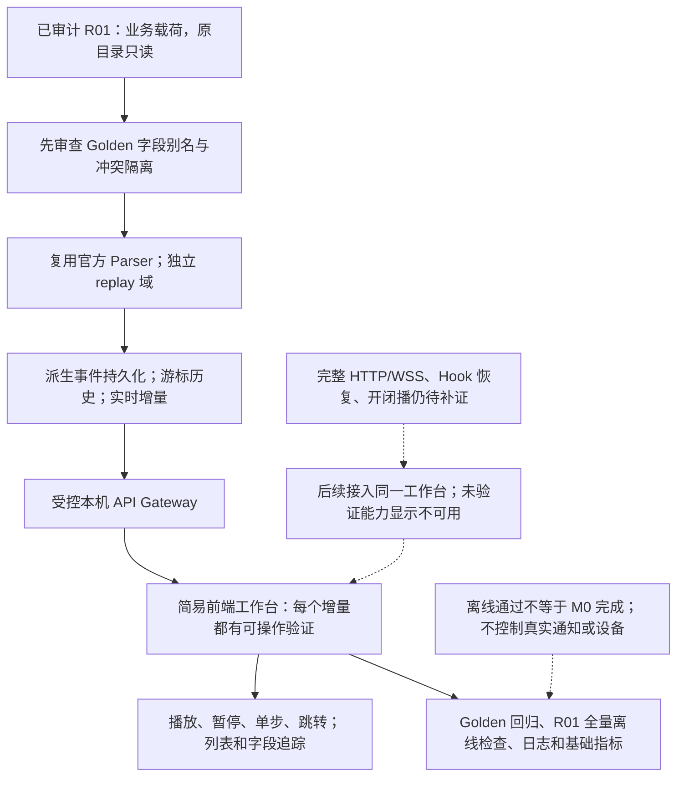

---

# 第二部分：AI／开发者严谨规格版

## B1. 适用边界、证据优先级与术语

### B1.1 范围

本规格覆盖 Windows 本地后端、逻辑 API Gateway、开发 GUI、采集、RAW、解析、去重、事件存储、SessionManager、ReplayEngine、日志与基础指标；后续业务和设备控制保留边界。前端可以运行在局域网其他电脑、手机或平板，本地后端默认仅监听本机。模块划分是逻辑划分，不强制物理拆分或单独进程。

不在范围内：云端多房间监控、其他独立服务的架构、项目外全应用启动脚本、OBS／伴侣内部实现、通知对端服务、旧 LiveDash 的整体改造、蛋仔短剧应用。可为这些端点预留本地适配契约，不把其后端、数据库、任务调度或管理页面并入本项目。

旧目录中的多房间监控设想、云端 API 分支和全应用进程控制，均被后续“仅本地、单房间、外部服务独立”的约束收敛。不得根据较早描述重新扩大范围。

### B1.2 证据优先级

1. 当前用户明确要求与引用对话中较新的用户修订。
2. 与其不冲突的用户较早陈述及上传文档的明确约束。
3. 本文件标明的规格建议。
4. 历史助手建议、代码符号、字段名称和未经验证的推测。

后两项不得冒充已确认事实。本文出现的代码路径、类名和数据结构是目标组织方案，不表示这些文件已经存在。

### B1.3 术语

| 术语 | 定义 |
|---|---|
| `anchorUid` | 主播稳定身份标识，用于区分不同主播；不使用昵称作主键 |
| `roomId` | 平台实际直播场次／房间标识，与网页路径 `web_rid`、主播身份分别保存 |
| `sessionId` | 本地内部场次运行或归档记录 ID；不是平台 RoomId，也不随每次采集重连重新生成 |
| `sessionKey` | 本地业务场次键，通常由 `anchorUid + roomId` 构成；复用处理见 B10 |
| `captureId` | 一段本地采集运行的标识；重启采集可变化，不决定直播是否新开 |
| `sourceEpoch` | 每次来源启停／切换的版本令牌；隔离旧来源迟到回调 |
| `processInstanceId` | 伴侣的一次进程实例，应包含 PID 与启动时间以防 PID 复用 |
| `sourceConnectionId` | 一条 HTTP/WSS 或采集桥接连接的关联标识 |
| `contextVersion` | 已确认房间上下文的版本；每次变更留迹，不修改旧事件快照 |
| `rawRef` | 指向原始文件与帧记录的稳定引用 |
| `mode` | `live`、`replay` 或 `test`，控制数据与执行出口隔离 |
| `eventId` | 本地事件身份；与平台 `msgId`、通知幂等键分别定义 |
| `evidence` | 能支持身份、房间、开播或闭播判断的原始观察与来源 |

所有平台 UID、RoomId、MsgId 等可能超过安全整数范围的值，对外及跨语言契约保持十进制字符串；不得经 JavaScript `Number` 或任何有损数值转换往返。未知值使用 `null` 与状态字段表示，不使用 `0` 或空字符串伪装真实身份。

## B2. 已确认约束清单

| 编号 | 已确认内容 | 来源 |
|---|---|---|
| C01 | 仅讨论本地直播系统，其他独立服务不属于项目 | 对话中范围收敛 |
| C02 | 同一时刻仅一个直播间、一个活动实时来源 | 对话中的 Listener 与本地使用约束 |
| C03 | `anchorUid` 区分主播，`roomId` 区分场次；允许人工选择其他房间测试 | 对话中的身份与场次说明 |
| C04 | LiveHookSource 是主来源，WebSource 是人工选择的兜底 | 对话中的新采集方案 |
| C05 | 热切换由人工触发，daemon 不负责来源切换 | 对话中的明确纠正 |
| C06 | LiveHook 模式不启动本地开播监控；Web 模式才启动 | 对话中的监控修订 |
| C07 | daemon 监视伴侣进程，协助采集恢复、握手与 HTTP 关联 | 对话中的职责说明 |
| C08 | 伴侣先开后采集无法捕获；采集先开后伴侣启动／重开具有高置信度 | 用户最新使用体验，作为开发前提 |
| C09 | 本地前端服务启动时先检测伴侣已运行情况，必要时提示重启 | 对话最后的流程确认 |
| C10 | 保留网页端适用的无操作干预、心跳等机制，不扩展为伴侣行为 | 对话中的采集功能要求 |
| C11 | 使用官方 Parser 与中文业务映射，并补充官方不支持字段的解析能力 | 对话中的 Parser 与补丁要求 |
| C12 | 借鉴 MsgId 去重，但全量保存源数据，不按支持类型过滤存储 | 对话中的去重与保存要求 |
| C13 | 需要避免伴侣崩溃重启导致同一场直播重复通知 | 对话中的通知去重目标 |
| C14 | 多通道通知、一对一／一对多、开播／上车／自定义业务共用分发 | 对话中的通知解耦说明 |
| C15 | 用户多个资料 table 共用稳定用户主键 | 对话中的数据库说明 |
| C16 | 上车门槛默认 99 钻，实际规则配置驱动 | 上传文档最新确认 |
| C17 | 基于 DouyinBarrageGrab 提取→解耦→重组→扩展→交付；必要冒烟，不以完整原版验收阻塞全部工程；不为统一语言重写 | 2026-10-12 用户最新执行方向 |
| C18 | RAW 在解析、去重和业务过滤前完成持久化；敏感信息不进入公开日志/接口 | 2026-10-12 修订任务 |
| C19 | 独立 SessionManager；房间创建、在播状态、实际推流状态、采集连接分开 | 2026-10-12 修订任务 |
| C20 | API Gateway 统一 REST/WebSocket；默认本机，远程访问明确启用并认证 | 2026-10-12 修订任务 |
| C21 | P0 完整工作日志、基础指标、实时弹幕无限回滚和可操作的简易开发 GUI | 2026-10-12 修订任务 |
| C22 | ReplayEngine 支持单步与跳转重建；禁止真实 Bark/ntfy、OBS、Stream Dock 副作用；真实 RAW 验证 | 2026-10-12 修订任务 |
| C23 | 技术栈不限语言；多对话受公共契约和统一审核约束 | 2026-10-12 修订任务 |
| C24 | references 只读且不入主 Git；文档、契约、进度正常纳入版本控制 | 2026-10-12 修订任务 |

以下详细设计是落实已确认约束的规格建议；公开契约版本与实际实现状态分别记录，不因文档写了接口便视为已实现。

## B3. 项目层级与模块职责

### B3.1 逻辑模块与实际目录

主仓库实际已有目录与权威文档入口见根 README。以下为目标逻辑模块，不表示现有源码、不是物理拆分承诺，也不限定 `.js` 或任何语言：

```text
LiveWorkbench 核心（P0）
├── Bootstrap / SourceController / RuntimeContext
├── LiveHookSource / WebSource / 对应 Listener
├── LiveHookDaemon：Hook 就绪、进程观察、恢复协调、诊断
├── RAW Recorder → FileStorage
├── Parser：官方 WebcastParser 基线 + 协议补丁/增强层
├── Dedup：消息幂等 + 礼物连击语义
├── EventBus / 持久化 EventStore
├── SessionManager / StateRepository
├── ReplayEngine / ReplaySource / ReplaySandbox
├── LogService / MetricsService
├── API Gateway：REST + WebSocket
└── 开发 GUI：接入、状态、日志、历史弹幕、RAW、Replay

ExternalIntegration（后续，当前只保留契约边界）
├── ActionDispatcher
├── OBS WebSocket Adapter / Stream Dock Adapter
├── NotificationDispatcher：Bark / ntfy 等
└── 上车、点歌、积分、粉丝、画布、数字人、AI 等业务
```

优先保持参考程序可运行，在明确的原始入口旁增加只读记录／适配端口，而不是先把稳定链路拆散。C#/.NET、Python、Go、Rust、JS/TS 或混合部署皆可评估；本地参考 BarrageGrab 的工程目标是 .NET Framework 4.6.2，最终宿主与桥接方案仍待基线验证后决定。官方 Parser 可通过独立运行环境接入，不因此将整个采集端重写为 Node。

外部设备可提交标准命令或事件，但经 API Gateway 校验与 ActionDispatcher 路由，不直接调用内部服务。后续板块不挤占当前 P0。

### B3.2 依赖规则

| 模块 | 输入 | 输出 | 职责限制 |
|---|---|---|---|
| Source | 控制命令、捕获连接 | 字节帧、HTTP 观察、技术状态 | 不产生正式场次，不算权益，不发送通知 |
| Listener | Source 观察、接入上下文 | 原始记录、解析结果、上下文证据、标准事件入口 | 不用进程事件伪造平台开播 |
| Daemon | 进程观察、捕获后端状态 | 技术状态、恢复动作结果 | 不切来源、不决定场次、不调用通知通道 |
| RAW Recorder | 捕获范围内字节与采集元数据 | 持久化 rawRef、durabilityAck | 不在去重之后才记录；失败时暂停下游解析 |
| API Gateway | 已认证查询/命令、订阅 | DTO、异步 operation 状态、实时增量 | 不暴露数据库、RAW 路径、代理或凭据 |
| LogService / MetricsService | 脱敏状态/错误、采样 | 工作日志、基础指标 | 不重复打印完整弹幕；不伪造模块 CPU/GPU 占比 |
| 官方 Parser | 字节与官方版本 | 官方原生解析结果或错误 | 不去重、不写中文标签、不保存业务账本 |
| 协议补丁 | 字节、官方结果、补丁版本 | 扩展字段/类型与来源 | 不覆盖官方事实，不伪造无法解码字段 |
| EventBus | 事件信封 | 按订阅分发 | 不自行判断开闭播，不充当数据库 |
| SessionManager | 已关联证据、人工场次命令 | 场次状态、统一生命周期事件 | 是场次唯一权威，不直接发网络通知 |
| 通知模块 | 通知意图、订阅与通道配置 | 发送任务、结果、失败状态 | 不监听进程自行认定开播 |
| 业务服务 | 标准事件、场次事件、人工命令 | 账本、状态、展示数据、通知请求 | 不回写原始包或官方 JSON |
| ReplaySandbox | 历史数据、规则和版本 | 临时状态、复盘视图、模拟输出 | 不取得 live 正式写入与执行端 |

业务服务从事件的不可变上下文或 SessionManager 的只读接口读取场次，不直接依赖“Listener 当前可变全局变量”，否则来源切换或异步延迟会把旧消息记到新房间。

## B4. Source 与 Listener 的采集契约

### B4.1 数据面与控制面

“Source 只产生原始二进制”保留为 WSS 数据面的原则。HTTP 是另一种协议观察，技术状态是控制面；不得强行把它们塞入官方弹幕 Parser。

建议 Source 暴露以下观察类型：

```text
RawFrame {
  captureId, sourceEpoch, sourceType, processInstanceId?, sourceConnectionId,
  receivedAt, frameSequence, direction, transport, bytes, observedMetadata
}
HttpObservation {
  captureId, sourceEpoch, processInstanceId?, sourceConnectionId?, receivedAt,
  method, urlPath, httpStatus?, requestBodyRef?, responseBodyRef?, headerRef?
}
SourceStatus {
  sourceEpoch, state, reason, lastObservedAt, recoveryAttempt?, captureReady
}
```

`bytes` 为捕获端实际提供的字节；必须标注保存的是网络帧、已重组消息、还是桥接后载荷，不能声称拥有捕获端未提供的原始网络层。采集元数据另存，不改字节。

HTTP 主体按原始字节保存；必要响应再解析为上下文证据。监听路径及请求信息的保存边界应限制在相关采集范围，具体 header、认证材料与保留策略列为待定，不采集无关应用流量。

### B4.2 Listener 统一模板

1. 标识 `sourceEpoch` 和 `mode`，过期回调不得进入当前业务路径。
2. 为收到的帧建立 `rawRef`，提交 RAW Recorder 并等待可靠持久化确认；过期帧仍归旧 capture 保存，随后停止其当前业务处理。
3. 取得 RAW 持久化确认后，WSS 进入统一 Parser 入口，HTTP 进入专用证据提取器；参考源码中已有的稳定传输解包路径先复用，再按审计计划适配官方解析基础，不建立重复业务链。
4. 官方解析成功时保存原生 JSON；失败时保存失败状态，原始包继续保留。
5. 从官方结果与可追溯补丁中提取上下文候选并形成上下文快照。
6. 执行消息去重，然后业务增强；证据也带身份与幂等键分发。
7. 把标准事件、证据事件和错误事件提交 EventBus；不由 Listener 判定整个场次是否已经通知。需要场次的业务消费必须等待 SessionManager 确认关联，未关联事件按 rawRef 暂存，不能因证据事件异步处理而先记入错误场次。

第 2 步可以内部异步排队，但下游必须等待持久化 ACK 后才解析、去重或发布业务事件，不能只把“排队成功”称为落盘。RAW 写入失败时暂停该输入的下游、启用有界缓冲并报告缺口。采集状态可即时显示；弹幕解析预览不绕过 RAW 门槛。durability 等级、重试与文件/事件数据库恢复边界见内部数据契约和 B19。

### B4.3 上下文

WebListener 在接入阶段获取／核对 `anchorUid`、`roomId`，LiveHookListener 运行时从 HTTP 房间响应、WSS 外层或嵌套 `common.roomId / common.room_id` 等已知信息提取候选。后者依据用户明确指出的恢复途径设计，不保证每种消息都含该字段。

上下文建议包含：

```text
ContextSnapshot {
  anchorUid, roomId, sessionKey?, contextVersion,
  sourceType, sourceEpoch, captureId, mode,
  identityState, roomState, evidenceRefs, capturedAt
}
```

规则：

- 请求所属进程、连接、当前选择主播和 payload 身份必须交叉关联；不把所见任意 RoomId 绑定到本人。
- `common.roomId / common.room_id` 可以帮助恢复房间归属，本身不证明有一次新的开播。
- 进程来自本人操作也不能替代平台主播身份核对。主播 UID 缺失时，允许保留不完整候选，不能用配置值覆盖相反的平台证据。
- 同一连接继承已确认上下文时必须记录继承来源；一旦出现冲突，暂停该冲突数据的业务消费并存诊断样本。
- 事件快照创建后不随 Listener 全局状态变化。后续补全通过索引／关联记录表达，不原地改写历史原始记录。
- 数据尚未归属时先存待归属区；关联成功后允许按序送入业务路径。缓存上限、磁盘暂存与延迟窗口必须显式配置，不无限积压。

## B5. LiveHookDaemon：启动、进程恢复与能力边界

### B5.1 启动前提

用户最新使用经验是本规格的权威开发前提：捕获端先就绪，再启动或重启伴侣。不得在文档或 UI 中声称“伴侣已开也可以无须重启保证捕获”。

“重注入”是用户描述的采集接入恢复目标，不预先指定必须采用 DLL 注入。可以复用原采集代理的重捕获能力；daemon 补齐监视、协调、状态反馈和失败处理。不得因此在已有能力外重复构造一套未经必要性判断的注入机制。

### B5.2 建议启动时序

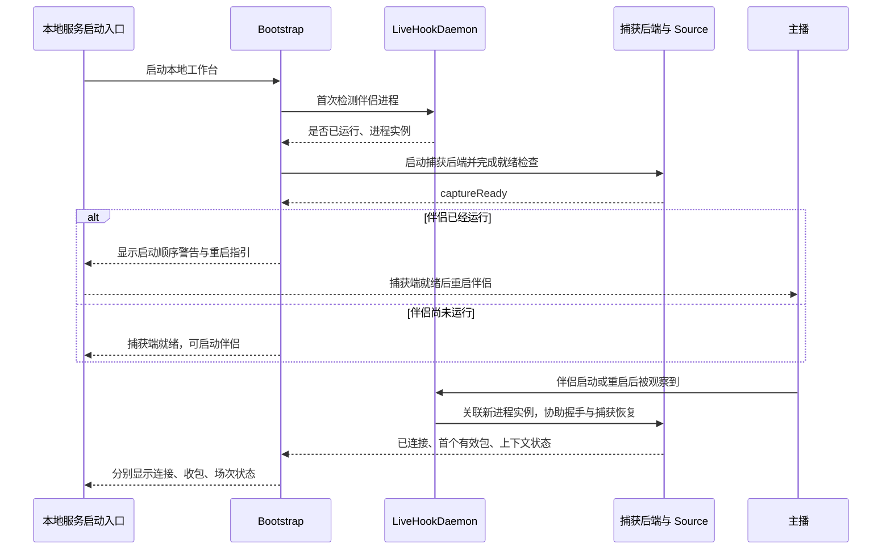

前端“打开”在本地后台服务启动入口落实为这条时序；后台已运行时重新打开浏览器页面，应读取现有状态，不重复启动 daemon，不自动创建新通知任务。

### B5.3 独立状态轴

不要用一个 `isLive` 表示所有状态。

| 状态轴 | 建议值 | 含义 |
|---|---|---|
| 捕获后端 | `STOPPED / STARTING / READY / FAILED` | 工具能否接收伴侣后续连接 |
| 伴侣进程 | `ABSENT / RUNNING / EXITED` | 技术进程是否存在 |
| 接入恢复 | `WAITING_PROCESS / NEEDS_COMPANION_RESTART / HANDSHAKING / CONNECTED / RECOVERING / FAILED` | 捕获接入过程 |
| 流数据 | `NO_DATA / RECEIVING / STALE` | 最近是否收到有效数据 |
| 直播场次 | B10 状态 | 是否已有可信平台开闭播证据 |

`READY / HookReady` 表示捕获端依赖和接收路径就绪，不等于收到数据或已经推流。`RUNNING` 不等于开播，`STALE` 不等于下播；进程观察不能推出直播生命周期。HookReady 的可测前置条件、超时、错误码见内部契约。

### B5.4 伴侣退出与恢复

1. 发出 `CompanionProcessExited` 与采集技术状态变化，保留退出原因的可信程度；观察到退出不一定知道是崩溃还是人工关闭。
2. 取消属于旧进程实例的握手任务、HTTP 关联和失效连接，防止 PID 复用污染。
3. SessionManager 将采集状态标为中断，但不生成 `LiveEnded`，不清空本场账本和通知发送记录。
4. daemon 保持捕获后端可接收新连接，观察新伴侣实例并协助接入。
5. 重新收到 HTTP/WSS 数据后核对身份和 RoomId；同一场则恢复，未知或冲突则等待证据／人工处理。
6. 恢复失败采用有上限的重试／退避并显示原因，持续守护；没有人工命令不得改用 WebSource。

daemon 不负责自动重启伴侣、自动开播、自动强杀伴侣或启动机架／OBS。用户所需的是伴侣再次启动后的捕获恢复。

### B5.5 本地系统重启

**[规格建议]** SessionManager 与通知模块持久化当前场次身份、未确认结束状态、发送任务和幂等记录。系统恢复时先载入这些状态，再接收新证据。不能从零内存状态直接认定“第一条包就是新一场”。

本地捕获进程或整个后台重启时，伴侣若仍运行，按启动顺序前提进入 `NEEDS_COMPANION_RESTART`。检测到必须重启时仍保留原场次记录；重启之后的同场证据走恢复路径。

### B5.6 项目外启动脚本接口

项目通过逻辑 API Gateway 提供状态与 HookReady：`GET /api/v1/system/status`、`GET /api/v1/hook/status`，字段包括 `backendReady`、`hookReady`、`restartRequired`、`selectedSource`、`reason`。它们是待实施的契约，不是已可调用接口；字段与权限以公共 API 文档为准。

若配置选择 WebSource，可返回本地 Web 接入就绪；不能伪造 LiveHook 捕获就绪。外部脚本的参数、进程编排和失败重试不在本项目实现。

## B6. 人工热切换事务与 Web 本地监控

### B6.1 SourceController

**[已确认]** 人工决定来源；**[规格建议]** SourceController 统一执行一次切换，序列化并发命令：

1. 记录切换命令、目标来源与当前主播，进入 `SWITCHING`。
2. 递增 `sourceEpoch`，停止旧来源接受新业务输入；旧监听回调立即失效。
3. 排空已经接收且已关联的旧事件，完成必要保存，停止旧 Source 和对应控制订阅。
4. 启用目标 Source 的 Listener 与控制能力，整个过程始终不出现两个活动实时来源。
5. 核对目标来源的身份、房间和场次，与 SessionManager 关联后恢复消费。
6. 记录成功／失败及采集缺口，不生成虚构的开播或闭播。

已经到达系统的迟到旧数据仍保存为旧 capture 的原始／诊断样本，但不得以新 epoch 进入 live 业务。已持久化旧记录不删除；无法归属的样本保留为待核对。

切换到相同主播、相同场次，保留本场状态、业务幂等、消息去重状态和通知记录；不同主播或不同 RoomId 则重新核对，不盲目继承。

目标失败时停止在“切换失败／未连接”状态，等待人工重试或选择。**[规格建议]** 不隐式切回旧来源；如后续需要恢复旧来源，也必须成为可见的人工命令。

### B6.2 来源与监控组合

| 选择来源 | LiveHookDaemon | LocalLiveMonitor | 开闭播证据入口 |
|---|---|---|---|
| LiveHookSource | 持续启用，直到人工停止或切走 | 停用 | 伴侣 HTTP/WSS 证据 |
| WebSource | 停止 active 守护与接入任务 | 启用，仅监控选中主播 | 本地监控结果、当前网页采集的关联证据 |
| 无来源／停止采集 | 停用 | 停用 | 不产生新的实时观察 |
| Replay | 不由回放启动 | 不由回放启动 | 仅回放域内历史证据 |

选择 WebSource 期间不能保留一个偷偷进入业务的 LiveHookSource。若未来为了更快切回预热捕获工具，必须单独设计并保证无第二条业务输入；当前不要求该能力。

LocalLiveMonitor 输出“带主播、房间、时间和原始依据的监控观察”，由 SessionManager 去重与判定。不直接 POST 通知通道；不监控多个房间；其查询方式、轮询间隔与连续状态确认阈值待定。

监控返回未知或请求失败，不等于下播。人工切换后撤销旧监控回调和旧倒计时；保留已形成的场次通知意图，是否继续发送由通知策略判断，不能因来源切换重复创建。

## B7. HTTP/WSS 证据与统一事件

### B7.1 HTTP 房间创建与在播候选

当前本地源码 `TitaniumProxy.cs` 的 create 路径核对进程名“直播伴侣”、HTTP 200，调用 `RoomInfo.TryParseStreamPusherCreate()` 后产生 `Action = 1`。静态阅读发现该函数末尾返回的 0 是本地解析结果码，并不意味着它已独立检查平台 `status_code`。目标适配不能把二者混淆。

目标步骤：

1. 保存相关 HTTP 响应原始字节后匹配 `/webcast/room/create`。
2. 核对当前伴侣进程实例、HTTP 状态、JSON 结构、实际平台业务响应码（若存在）与身份。
3. 保留本地解析结果码，与平台业务码分别记录；缺少字段不能推测成功。
4. 读取 `data.id_str`、实际存在的主播与标题，形成 `RoomCreatedObserved`。
5. 独立记录平台在播观察，例如参考解析器将 `data.status == 2` 映射为 `IsLive`；此处仅是源码解释，仍须真实 HTTP/WSS 样本核对语义。
6. SessionManager 决定房间创建、平台在播与实际推流三轴；create 单独成功不直接承诺推流已经开始，不直接触发通知。

实现沿用成熟的 HTTP/房间解析能力并加薄适配层；不得因换模块名重新发明代理。参考 `Action = 1`、基于当前 ticks 合成的下游 MsgId 不能直接作为场次或通知幂等依据。完整静态证据、行号和待验证差异见源码迁移文档。

### B7.2 闭播候选

对话中的两条路径作为待样本落实的目标依据：

- 与当前房间关联的 `/anchor_finish_info` 有效结束响应。
- WSS 解码出 `ControlMessage.status = 3`，且能关联到当前房间。

不能仅凭 URL 命中就结束当前场次。静态源码会核对伴侣、HTTP 200，并读取 `data.owner`、非零用户 ID 与 `own_room.room_ids_str` 形成结束事件；这证明存在代码路径，不证明所有实际下播情况已经覆盖。目标业务成功/结束条件与房间关联仍须真实样本确认；字段不足只发观察/诊断，不发正式 `LiveEnded`。

状态为 3 的消息若属于旧房间、旧 epoch 或无法归属，不能结束当前新场。晚到的旧场证据可补历史记录，由明确的历史处理路径消费。

### B7.3 WSS 恢复与消息处理

WSS 原始帧先保存；重组、解压、外层与内层解码遵循当前 Parser／采集工具能力。若捕获端只输出重组后的 payload，必须在保存元数据中说明，不能推称保留了网络所有控制帧。

伴侣 HTTP room 响应缺失时，可从已经解析的常见消息嵌套 `common.roomId / common.room_id` 恢复房间；缺少主播身份时结合当前连接已有的可信绑定。外层与内层房间信息不一致时保留冲突，不随意择一。

伴侣数据中的统计、预警等类型进入协议补丁路线；不支持类型仍保留原始数据与未知类型索引。网页心跳维护仅由 WebSource 负责，LiveHookSource 不擅自向伴侣 WSS 注入网页心跳或改业务请求。

### B7.4 建议事件名称

| 事件 | 发出方 | 可否直接触发真实开播通知 |
|---|---|---|
| `CompanionProcessStarted / Exited` | daemon | 否 |
| `CaptureReady / CaptureInterrupted / CaptureRecovered` | Source/daemon 经 Listener | 否 |
| `RoomContextResolved / ContextConflict` | Listener | 否 |
| `RoomCreatedObserved / PlatformLiveStateObserved / PlatformStreamStateObserved / PlatformLiveEndObserved` | Listener | 否，先经过 SessionManager；不能互相替代证据 |
| `WebLiveStateObserved` | LocalLiveMonitor | 否，先经过 SessionManager |
| `LiveStarted / LiveEnded / SessionRecovered` | SessionManager | 只有 `LiveStarted` 按通知策略触发开播意图 |
| `QueuePrepareRequested / CustomNotificationRequested` | 相应业务服务／人工命令入口 | 按各自通知策略 |
| `ParseFailed / StorageFailed / NotificationDeliveryChanged` | 相应模块 | 只触发诊断或明确配置的运维通知 |

旧示例 `Hook_LiveStart` 若实际表示“进程启动”，应重命名为进程事件；不得同时承担进程状态与正式开播两种含义。合成事件可标 `isCustomHookEvent`，但还必须标明事件类别和生产者；不能靠一个布尔值判断是不是平台开播。

## B8. 官方 Parser、协议补丁与业务补丁

### B8.1 三层分开

| 层 | 处理 | 保存结果 | 不应出现的逻辑 |
|---|---|---|---|
| 官方 Parser | 官方版本的协议解码 | `official-json`，含版本引用 | 中文标签、去重、权益、通知 |
| 协议补丁 | 补充不支持的类型/字段、使用扩展字典解码 | `extensions`，含补丁版本与证据 | 覆盖官方字段、无样本猜值 |
| BusinessAugmentor | method 中文说明、标准事件映射、来源/自定义事件标记 | 业务事件与派生视图 | 修改原始 bytes 或原生 JSON |

推荐将扩展结果放在独立命名空间，如 `{official, extensions, decodeStatus, versionRefs}`。`official` 引用／复制官方结果但不原地修改；中文标签放在增强事件的 `labels` 中。

如果某类扩展只能通过一个派生 Parser 解码，也必须保留未改官方基线，记录派生版本，并将其结果归为扩展结果，不宣称是官方原生输出。具体补丁机制由实际 Parser 扩展能力决定。

### B8.2 版本与错误

原始记录索引应关联官方 Parser 版本／内容哈希、官方 proto 字典版本、协议补丁版本、业务映射版本、规则版本。官方更新可以升级基线，但不把业务改动混进官方版本。

候选版本先用代表样本验证，再切换；失败保留旧可用版本。历史重解析明确指定版本，不静默覆盖旧原生 JSON；新增一份带版本的解析结果。

解码失败、部分解码、未知类型分别记录。没有完整官方 JSON 时保留原始字节、错误和已明确的部分信息；不能造一个“成功的纯净 JSON”。补丁失败不影响原始保存，也不吞掉官方成功结果。

中文映射主要帮助理解，原始 `method` 和字段名仍保留。实体类源码可用作业务含义参考，但不能把简化实体映射当成完整协议存档。

## B9. 消息去重与业务幂等

### B9.1 顺序与作用域

目标顺序：**原始保存 → 官方解析及原生 JSON 保存 → 协议补丁 → MsgDeduplicator → BusinessAugmentor → EventBus → 业务**。

去重结果保存在派生索引中，不删除原始样本。源码中的 method+msgId 有界缓存可以作为起点，但必须适配主播/RoomId 上下文，并验证原有礼物连击增量规则。去重用于避免同一平台消息在重连或人工切换时重复进入业务，但不是丢掉协议类型的过滤器。

**[规格建议]** 有效 MsgId 的去重键为 `modeNamespace + anchorUid + roomId + method + msgId`，平台字段语义最终仍需用样本确定。来源类型、连接 ID 和 sourceEpoch 不进入跨来源消息幂等的核心键，否则人工切换后的同一消息会被当成新消息。

未知／零值／缺失 MsgId 不使用统一空键。可以采用类型限定的载荷哈希与短时间窗口作为启发式降重，但必须标注策略；不能把内容相同的两条合法弹幕永久合并。无可靠身份的消息先暂存归属，若必须预览，预览不能结算权益。

### B9.2 缓存与可靠边界

短期消息去重缓存跨同场重连与来源切换保持，按场次和时间窗口受限。窗口长度、容量、过期策略待定；不能承诺有限内存去重可以覆盖所有历史重传。

关键账本另用持久化业务幂等键处理，例如 `sessionKey + actionType + sourceEventIdentity`。消息缓存淘汰、本地进程重启或补丁重解析后，也不能再次赠送资格／扣积分。

去重至少分四层，不共享一个“已处理”标记：

| 层 | 示例键 | 防止的问题 |
|---|---|---|
| 平台消息 | 房间 + method + MsgId | 同包重复到达 |
| 场次转换 | 场次 + 转换种类 + 状态版本 | 同场重复开闭播 |
| 业务命令／账本 | 业务请求 ID 或事件身份 + 动作 | 重复入队、兑换、扣减 |
| 通知发送 | 通知意图 + 收件人 + 通道 | 同意图重复发送 |

### B9.3 累计字段

礼物连击或统计更新若是累计值，不能把每次新消息的累计数直接再次相加。应按对应连击／统计对象的身份计算新增量，保留终止状态、乱序和回退异常。

不同 MsgId 不代表可以重复累计同一连击余额。榜单累计贡献、礼物推算贡献和可消费权益分别维护；跨通道数据不能直接相加。具体连击身份字段和累计修正规则待样本确认。

## B10. SessionManager 与开闭播状态机

### B10.1 唯一权威与身份

SessionManager 负责本场关联、场次状态、生命周期幂等和恢复；Listener 提供上下文候选，daemon 提供技术观察，通知模块只消费已判定的生命周期事件。

**[已确认]** 当前按主播与 RoomId 分类场次。**[规格建议]** 默认 `sessionKey = anchorUid + ':' + roomId`，并保留独立本地场次记录 ID，防止未来复用时改写旧记录。

本地 `sessionId` 标识内部场次记录，`captureId` 标识采集运行，两者均不取代真实 `roomId`。同场切源、刷新与 Hook 重连保留 sessionId；若平台在确证结束后重新使用同一 RoomId，本地是否加 `generation` 尚未确认。不能既永久按 RoomId 禁止推送、又承诺相同 RoomId 的下一次真实开播会推送；该冲突必须显式收敛，见 P02。

### B10.2 双轴状态

场次状态建议为 `UNRESOLVED / CREATED / LIVE / ENDED / NEEDS_RECONCILIATION`；另外维护采集状态 `CONNECTED / INTERRUPTED / RECOVERING / STOPPED`、房间状态 `UNKNOWN / CREATED / ENDED`、平台直播状态 `UNKNOWN / LIVE / ENDED`、实际推流状态 `UNKNOWN / PUSHING / NOT_PUSHING`。各轴记录 evidenceRef 和更新时间；未知不当 false。平台显示在播不自动证实正在持续推流。正式开播策略基于经过确认的在播证据，是否要求额外推流证据列为 P23；不凭进程存在、room/create 单独成功或普通收包自动判断。

`UNRESOLVED` 不是下播，`INTERRUPTED` 不是结束。可出现 `LIVE + INTERRUPTED`，表示已知本场未收到结束证据，但目前无法继续观察。

| 当前状态 | 新证据／命令 | 行为 | 生命周期输出 |
|---|---|---|---|
| UNRESOLVED | 只有有效房间创建证据，尚无可信在播证据 | 建立 CREATED 候选，推流保持 UNKNOWN | `RoomCreated`，无 `LiveStarted` |
| UNRESOLVED / CREATED | 可信在播证据，身份/房间完整，无已存同场记录 | 建立 LIVE 场次，持久化转换 | `LiveStarted` 一次 |
| UNRESOLVED | 只有恢复的 RoomId／普通互动 | 关联已有场次；无记录则标为中途接入候选 | 不默认制造 `LiveStarted` |
| LIVE | 同场开始证据 | 补上下文、去重，不重置业务 | 无新的 `LiveStarted` |
| LIVE + INTERRUPTED | 同场可信数据恢复 | 恢复连接与关联 | `SessionRecovered` |
| LIVE | 当前场次可信结束证据 | 转 ENDED，触发一次归档意图 | `LiveEnded` 一次 |
| ENDED | 同场重复结束证据 | 保留证据引用 | 无重复 `LiveEnded` |
| ENDED | 相同 RoomId 的迟到开始证据 | 检查时间/证据，不能自动复活旧场 | 无；冲突则待核对 |
| ENDED | 已确认新的开播，身份/新场次键成立 | 建立新 LIVE 场次 | 新场 `LiveStarted` |
| LIVE | 不同 RoomId，但没有旧场结束证据 | 进入 NEEDS_RECONCILIATION，保存新候选 | 不擅自结束旧场并发新开播通知 |
| 任意 | 伴侣退出、WSS 断开、静默超时 | 仅变采集状态 | 无 `LiveEnded` |
| 任意 | 人工停止采集／切来源 | 停采集或执行切换 | 不等于结束直播 |
| LIVE | 人工明确结束／归档命令 | 留操作人/原因，走人工结束策略 | 是否向外通知见独立策略 |

中途首次接入正在直播的房间，可以建立带 `startEvidenceMissing` 的场次记录用于收包与统计，但不能声称准确开播时间已知。是否补发开播通知是独立待定策略，默认建议不补发。

### B10.3 顺序与冲突

同一主播的场次证据串行处理。转换前检查 `mode`、epoch、身份、房间、证据时间和记录版本。过期回调不能触发当前转换；平台时间与本地接收时间分别保存，不混用。

平台时间缺失时不能单靠接收先后判断“迟到开始”一定是新开播。来源切换新证据、旧连接迟到事件和通知任务均要引用对应场次。

闭播确认后再遇到可信新开播可走新场流程，但“必须先收到某两个结束接口才能允许任何新场”的绝对规则会阻塞遗漏结束包的恢复。**[待定]** 对不同 RoomId 缺失旧结束证据的情况，本文件建议由人工确认或另行选定的明确恢复策略解决，不猜测发生时间、不静默结算。

### B10.4 原子性建议

状态转换、转换幂等记录与待分发生命周期事件使用同一持久化事务／等效日志提交。提交后 EventBus 可重复发布，消费者按事件身份幂等处理。

不能“先发通知，再存场次”。否则本地系统在两步之间崩溃后仍可能重复发送。具体数据库与 outbox 实现不在本文冻结。

## B11. EventBus：分发与可追踪性

### B11.1 建议信封

```text
EventEnvelope {
  schemaVersion, eventId, eventType, producer, origin,
  mode, runtimeNamespace, sourceType?, sourceEpoch?,
  captureId?, processInstanceId?,
  anchorUid?, roomId?, sessionId?, sessionKey?, contextVersion?,
  msgId?, userId?, occurredAt?, receivedAt,
  causationId?, correlationId?, rawRefs[], versionRefs,
  payload
}
```

`origin` 区分 `platform / daemon / monitor / user / derived`。`sourceType` 描述采集来源，`producer` 描述事件生产模块，不混为一项。合成进程事件允许 `roomId = null`；不得为了满足类型校验而造 RoomId。

EventBus 不修改 payload 的官方部分。订阅者收到事件后不能影响其他订阅者看到的内容；可使用不可变约定或拷贝。

### B11.2 事件类别与消费者

| 类别 | 典型消费者 | 约束 |
|---|---|---|
| 技术状态 | 总览、诊断、SourceController | 不作为真实开播通知触发器 |
| 上下文／平台生命周期证据 | SessionManager | 不直接向通道发送 |
| 正式生命周期 | 业务服务、归档、通知路由 | 同场转换幂等 |
| 平台业务事件 | 统计、粉丝、规则、数字人、AI | 业务幂等、按需消费 |
| 人工命令 | 对应业务服务 | 命令 ID、防重复执行、结果反馈 |
| 业务结果与展示事件 | 画布、控制台、记录 | 不反向重复结算原事件 |
| 通知请求与发送结果 | Router、Dispatcher、控制台 | 防止结果重新触发同一请求 |

EventBus 本身不保证持久化和“恰好一次”。建议采用可重试分发加幂等消费者；重要事件先入日志／outbox，UI 预览事件可采用较轻方式。业务成功不能只靠一次内存 emit。

订阅者失败被隔离并记录，不能让某个 AI／画布异常阻塞原始保存。对慢消费者设置有界队列、积压指标与重试策略；不无限堆积。需要因果顺序的账本与场次采用串行处理；不要求所有 UI 渲染全局串行。

## B12. 通知路由、策略与发送幂等

### B12.1 一条公共通知链

```text
SessionManager.LiveStarted ─┐
QueueService 准备请求 ───────┼→ NotificationRouter
人工/业务自定义请求 ────────┘       ↓
                              明确的通知意图
                                    ↓
                          持久化任务 + 收件人/通道幂等
                                    ↓
                         NotificationDispatcher
                                    ↓
                         本地通道 Adapter → 对端
                                    ↓
                            成功/失败/未知结果
```

Router 负责订阅条件、收件人、通道、模板、链接、静音／优先级与策略；Dispatcher 负责入队、发送、重试、结果记录。自定义推送前端负责编辑和发命令，不承担后端幂等与恢复。

平台生命周期通知、上车准备通知和自定义推送使用不同的 intent 类型，互不覆盖去重记录。同一用户可订阅多个通道；一对多展开为多条独立发送任务。

弹幕监听通道先定义为本地订阅／展示接收接口。现有资料不能证明项目已拥有抖音自动发弹幕能力；若未来需要平台发言，单独明确适配接口与权限，不能把“弹幕监听”当作已具备的发言出口。

### B12.2 业务幂等键

建议分开定义：

```text
liveStartIntentKey = sessionKey + ':live-start'
queueIntentKey     = queueRoundId + ':' + userId + ':' + notificationStage
customIntentKey    = stableRequestId
deliveryKey        = intentKey + ':' + recipientId + ':' + channelId
```

键值使用确定性编码，避免分隔符歧义。收件人／通道名称只是示例，最终使用稳定内部 ID。通知重试沿用原 intent 与 deliveryKey；请求按钮双击沿用同一业务命令 ID。

开始发送前原子地占用任务，发送后记录实际结果。状态建议为 `PENDING / SENDING / SENT / FAILED / UNKNOWN / CANCELLED / EXPIRED / SUPPRESSED`，有尝试次数、最后错误、下次重试时间和过期时间。

不使用“先标已发送再 POST”的做法，否则失败被错误当成功；也不使用“每次内存收到事件就 POST”的做法，否则重启后重复。

若对端已收但本地未拿到响应，状态是 `UNKNOWN`。持久化本地幂等只能减少本地重复，不保证缺少幂等接口的第三方恰好一次接收。该状态的自动重试／人工核对策略需要明确。

### B12.3 场次级与收件人级

同场重复开始证据不能重新创建通知意图。已发送的通道不重复，失败通道可按策略重试，不因部分失败而重发全部。

**[规格建议]** 意图创建时记录收件人和通道快照；中途新增订阅是否补发、模板变更是否重发、通道切换是否补发均作为独立规则，不能由配置刷新意外触发。

Bark、ntfy、小智 MCP 对端属于项目外。各 adapter 只负责请求转换和结果解释；认证配置由本地配置能力提供，不把秘钥写进事件、原生 JSON 或可导出的业务日志。

### B12.4 自动／关闭／手动

较早对话提出通知自动、关闭、手动控制；可保留为本地“开播通知策略”，与上车通知、自定义通知分别配置。

- `auto`：可信 `LiveStarted` 生成一次通知意图。
- `off`：记录抑制结果，不向通道发送。
- 手动发送：产生带独立请求 ID 的明确命令；再次向同场同收件人发送应标为人工重发，不能伪装一次新的开播。
- 恢复自动：默认建议只影响以后新意图，不自动补发已抑制历史意图。

原先“APIserver=true 自动关闭本地开播通知”依赖外部服务状态，按最新项目边界不作为本项目必需联动。将来是否接收外部抑制信号另行设计；本文不建立云端／本地双套监控逻辑。

### B12.5 60 秒无 RoomId 兜底

**[待定，不默认启用]** 旧流程把进程启动当开始计时依据，会在恢复时重复推主页；仅按已推 RoomId 去重也覆盖不了 RoomId 未知的通知。

若用户选择启用，建议以下条件一起成立：

1. 有可信新的开播意图或人工明确意图；仅 `CompanionProcessStarted` 不创建任务。
2. 任务使用持久化 provisional intent ID，关联主播、证据与开始时间；重启进程／后台不得重置计时。
3. 存在尚未结束且已通知的已知场次时，恢复观察优先关联该场次，不新建主页兜底任务。
4. RoomId 在期限前到达：原子绑定到同一 intent 并取消超时路径，生成直播间链接任务。
5. 到期仍未知：如果策略允许，发送一次主播主页；需要有效主播主页标识，不能假定 `anchorUid` 直接等于可打开的主页地址。
6. 主页已发送后 RoomId 再到达：绑定原 intent 的 alias，默认不再自动发直播间链接；若需要追加链接，必须作为独立补充通知类型明确启用。
7. 期限与 RoomId 恰好并发到达：通过事务／原子状态转换选中一个出口，不能两条路径同时发送。
8. 结束、过期、目标主播切换时取消未发送任务；同场来源切换不新建任务。恢复时核对 deadline 与场次状态，避免发送陈旧开播消息。

“60 秒”只是旧示例数值，不是已冻结超时值。若没有足够证据区分新开播与同场恢复，建议等待明确证据或人工处理，不声称可以在所有未知 RoomId 情况下自动去重。

## B13. 原始保存、目录分类与派生记录

### B13.1 分层保存

```text
data/
├── intake/
│   └── <captureId>/              # 身份/房间未确认时先保存；不是丢弃区
├── anchors/
│   └── <anchorUid>/
│       └── rooms/
│           └── <roomId>/
│               └── <sessionId>/
│                   ├── raw-bin/          # 捕获字节，不经业务过滤
│                   ├── http-raw/         # 相关 HTTP 原始观察
│                   ├── official-json/    # 官方 Parser 原生输出
│                   ├── extensions/       # 协议补丁解析结果
│                   ├── indexes/          # rawRef、归属、时间、解析/去重状态
│                   ├── business-events/  # 命令、账本变更、展示/通知意图引用
│                   ├── snapshots/        # 本场首尾状态与明确版本
│                   └── manifest.json     # 版本、来源、覆盖时段、缺口和完整性
└── replay/<replayRunId>/          # 临时输出，与正式数据分离
```

`sessionId` 是本地记录标识，目录仍按主播／RoomId 分类；不强行把“存在一个子目录”解释为平台一定有新一场。

intake 保存的字节无需为了补身份改写内容。建议通过 manifest 的稳定引用关联到正确场次；若后续物理迁移文件，必须保持引用可解析并原子更新索引。文件名与文件内容哈希不随业务标签变化。

### B13.2 各记录约束

| 记录 | 保存时点 | 内容要求 |
|---|---|---|
| 原始 bin | 收到后持久化，ACK 后放行解析 | 字节不修改；包含重复、未知、失败样本 |
| HTTP 原始观察 | 捕获时 | 请求/响应关联、进程实例、路径、主体引用 |
| 官方 JSON | 官方解码成功或明确部分成功 | 原生结果，不追加中文标签或业务状态 |
| 扩展解析 | 补丁解析后 | 扩展版本、字段来源、冲突/失败 |
| 索引/manifest | 输入、解析、归属等阶段 | 覆盖区间、时间、rawRef、文件哈希、缺口、版本 |
| 业务 journal | 人工操作与业务提交时 | 命令 ID、前后状态/变更、规则版本、因果引用 |
| 通知状态 | 意图创建与每次发送尝试 | 可恢复幂等与结果，不塞入官方 JSON |
| 本场快照 | 首次基线、结束归档或明确检查点 | 字段状态、事件边界、规则和重建版本 |

64 位编号保持字符串。JSON 的序列化格式可与内存结构不同，但数值语义不得丢精度；无法无损表达的字节保留原始文件引用。

“纯净存储”针对原始字节和官方解析结果，不排斥另存采集元数据、错误、索引和业务记录。反过来，业务记录不能冒充原始平台消息。

### B13.3 故障和覆盖

磁盘满、写入失败、索引失败必须暴露；建议暂停会产生不可追溯结算的业务，保留有限缓冲并提示实际缺口。不静默丢数据后仍显示“全量已保存”。

帧边界、文件分段、滚动大小、落盘确认时点、哈希策略、保留期限和磁盘预算待定。统计完整性至少区分“捕获缺口”“保存缺口”“解析缺口”。

所有重新解析、归档重试和派生重建记录版本与输入边界；不覆盖原始输入。归档失败不能删除未完成场次记录。

## B14. 业务消费、资料主键与正式写入

### B14.1 共用数据职责

沿用附件术语：`S` 是实时输入；`RAW` 是原始平台输入；`N` 是本场首尾状态与统计；`D` 是长期资料；`Q` 是上车账本与队列；`L` 是点歌积分与队列。

原附件将业务操作也笼统列在 RAW 范围，本文为了保证原始数据纯净，将其具体落实为独立 `business-events`，两者共同支撑复盘。

**[已确认]** 抖音基础资料、收货地址、蛋仔信息、推送订阅等 table 共用稳定用户主键。建议设置内部 `userId` 与平台 UID／sec_uid 映射关系，地址和订阅分别管理。具体主键类型与数据库仍待定。

观众 `userId` 与主播 `anchorUid` 不混用；同一观众跨场可归同一个长期档案，本场行为按 sessionKey 分开。昵称、抖音号、备注名不能作为唯一合并依据。

### B14.2 业务消费表

| 服务 | 主要输入 | 权威状态与输出 | 保护规则 |
|---|---|---|---|
| 统计/本场服务 | 平台事件、场次事件 | 互动统计、本场观众、首尾记录 | 累计值不重复加，离开观众不丢 |
| 粉丝服务 | 用户身份、事件、人工编辑 | D、资料变更与查询 | 自动有效值不覆盖人工字段；未知身份不猜 |
| 上车服务 | 指令、资格事件、人工命令 | Q、局数、队列、准备通知请求 | 权益与排队分开；操作幂等与撤销留迹 |
| 点歌服务 | 点歌命令、积分来源、播放器结果 | L、待播队列、扣退记录、歌词视图 | 扣减与退回各自幂等，不沿用 Q 余额 |
| 互动服务 | 标准事件、规则配置 | 公告、语音与动作请求 | 冷却、优先级、聚合、执行记录 |
| 字幕语音服务 | 字幕片段、播报请求 | 字幕存档、语音调度状态 | 静音、队列上限、超时、防重复播报 |
| 画布服务 | 业务视图、样式、主题 | 只含展示内容的本地页面 | 不从页面列表反推资格，不包含管理操作 |
| 数字人服务 | 资源、确定性规则、合法动作计划 | 动作/气泡/特效、恢复待机 | 高频聚合、冷却、资源失败回退 |
| AI 助手 | 候选弹幕、知识、只读实时状态 | 回复候选与有限行为计划 | 不自行加权益、扣积分、执行任意代码 |
| 归档服务 | LiveEnded、人工归档命令、输入范围 | 快照、报告、重建结果 | 归档与正式结算分别幂等，不重复消费历史礼物 |

展示、数字人、AI 的错误应局部降级；不能破坏采集和原始保存。AI 查询带数据更新时间，缺数据时给未知；回复与动作必须通过合法性校验再进入相应执行端。

旧资料迁移或适配属于后续选项；同一用户档案、同一权益账本始终只有一个权威正式写入方。不能同时由旧新两个系统结算同一礼物。

### B14.3 规则口径

- 默认上车门槛 99 钻，规则配置驱动；兑换局数、累计范围与反复领取条件另行明确。
- 新粉灯牌 2 级体验 2 局、墨镜（历史等值 99 钻）2 局为上传文件记录的用户历史规则；“新粉”范围、重复领取、实际匹配方式需要配置化。
- 会员、星守护、灯牌、付费等级分别维护；字段存在不等于自动授予某权益。
- 超车门槛、次数、预约、准备倒计时、跳过资格保留、扣局时点，按生效规则版本执行，不从历史助手示例写死。
- 贡献值、上车资格、点歌积分、超车次数是不同账本或指标，不能互相替代。

规则配置保留稳定 ID、版本和生效时间。页面说明、实际计算、AI 知识和试算读取同一版本。配置变化不自动重新结算旧事件；“按新规则试算”只能在隔离域输出结果。

## B15. ReplayEngine 隔离、时间轴与重建

### B15.1 隔离边界

ReplaySource 可复用 Parser、补丁、去重和业务计算，但运行于独立 `runtimeNamespace`，拥有自己的 Context、EventBus、SessionManager、去重缓存、仓库和模拟出口。

| 资源／行为 | live | replay/test |
|---|---|---|
| 历史原始文件 | 可追加当前捕获，不覆盖旧文件 | 只读 |
| 场次与账本仓库 | 正式写入 | 临时副本／内存或隔离目录 |
| 通知 Adapter | 按策略真实发送 | 替换为记录模拟结果的端口 |
| 正式队列/积分/资料 | 可授权更新 | 无正式写入接口 |
| TTS、播放器、数字人、画布 | 当前直播执行出口 | 隔离预览，不推到 live 页面/设备 |
| daemon／本地监控 | 由实时模式控制 | 不启动，不操作伴侣 |
| EventBus 与幂等空间 | live namespace | 每次回放独立 namespace |

防护需要同时存在于装配层、持久化仓库与执行端，不能只靠 UI 的“回放模式”勾选。模拟输出仍可查看“本来会发什么通知／做什么动作”，但没有真实出口。

### B15.2 控制能力与验证

ReplayEngine 提供创建、播放、暂停、单步、跳转、状态重建和停止；控制命令与状态版本见公共 API 文档。单步推进一个定义明确的持久化输入单位；跳转先恢复基线/检查点再重放至目标，不能只换时间标签。

实时数据库、外部副作用与回放隔离。除了 Bark/ntfy，还禁止回放控制 OBS、Stream Dock，设备输入只能进入 replay 域。必须用经选择的真实 RAW 样本验证上下文、去重、未知/失败记录、时间序列和副作用阻断；模拟数据仅用于补充分支，不能替代真实样本验收。本次未执行该验证。

### B15.3 两种重建方式

1. **事实回放**：按当时业务 journal 还原已发生的操作与结果，使用当时规则／版本。
2. **重新试算**：从原始平台数据与独立人工命令输入重新运行指定规则，在隔离仓库比较结果。

不能一边回放“礼物导致资格增加”的原始事件、一边再次应用 journal 中同一资格增加的结果，造成双重结算。journal 必须区分人工命令、派生结果与检查点，并有因果 ID；每次重建选择一种权威恢复路径。

历史手动拖拽、预约、跳过、局数调整等没有平台包对应，必须从独立业务记录恢复。缺少业务日志时复盘明确表示只能还原平台互动，不能保证 Q/L 状态完全一致。

### B15.4 时间、定位与完整性

时间索引用于查询附近事件；完整状态重建需要初始状态与此前事件，或可验证的检查点。拖动到某时刻时恢复该时刻之前的因果顺序，不直接从附近几条记录推导余额。

区分事件发生时间与接收时间，倍速播放使用虚拟时钟。去重时钟和倒计时不引用当前真实时间，否则同一回放每次结果会变化。

停止／重新开始／定位回放不复用正式幂等状态。版本缺失、数据缺口、未知类型和样本不完整列入结果说明。

历史“10 秒加载可接受”是待实测目标，应固定机器、代表性场次、冷／热加载和统计口径再验收，不能引用历史估算宣称已经达到。

### B15.5 重建写回

Replay 本身无正式写回。若需要由 RAW 重建归档／长期统计，走 ArchiveService 的单独受控命令：指定输入边界、版本、目标记录与幂等策略，先给差异预览，再更新允许的目标。通知、语音、真实队列和消费账本不因为“重建统计”被再次执行。

## B16. 完整运行场景

### 场景 S01：正确顺序首次接入

本地服务启动 → daemon 检测伴侣未运行 → 捕获后端 READY → 用户启动伴侣 → 新进程关联与握手 → 原始 HTTP/WSS 保存 → 有效 create 响应与身份关联 → 建立 CREATED 候选 → 得到可信在播证据，推流状态独立记录 → SessionManager 按确认策略发一次 LiveStarted → Router 生成一次意图 → 各收件人/通道发送 → 平台业务消息经去重消费。

### 场景 S02：伴侣已经开启

本地服务启动检测到伴侣已运行 → UI 提示顺序不满足 → 捕获端先达到 READY → 用户重启伴侣 → daemon 接入新实例 → 根据可信证据建立／恢复场次。重启提示、进程存在和握手成功都不直接发送开播通知。

### 场景 S03：直播中伴侣崩溃再启动

伴侣退出 → 采集 INTERRUPTED，本场 LIVE 状态保留 → daemon 保持捕获就绪 → 用户重新启动伴侣 → 新实例接入 → 从 HTTP 或 common.roomId / common.room_id 恢复房间 → 同场 SessionRecovered → 消息去重与业务幂等继续有效 → 已发送开播通知不重发。

如果新 RoomId 与旧场冲突，则保存证据并进入待核对，不能为了保持流程顺畅自动创建新通知。

### 场景 S04：人工切到 WebSource 后切回

用户发切换命令 → 旧 epoch 失效并停止 LiveHook 活动链 → 开启 WebSource 与单主播 LocalLiveMonitor → 核对上下文 → 同场继续消费与保存；再人工切回时先停止网页和监控 → 启动 LiveHook 捕获准备并按启动顺序提示 → 同场恢复。切换不是开闭播，采集缺口写入 manifest。

### 场景 S05：真实下播后新开播

收到当前场有效结束证据 → SessionManager 发一次 LiveEnded → ArchiveService 保存结束意图和归档进度 → 新的有效开始证据与新场次键成立 → 新场 LiveStarted → 新通知意图。重复下播证据不重复归档，重复 create 不重复开播。

同 RoomId 再开或缺少旧场结束证据的分支按待定策略处理，不用历史通知记录粗暴阻断所有以后通知。

### 场景 S06：整个本地系统重启

恢复持久化场次、业务账本和发送状态 → 检测伴侣运行情况 → 如伴侣已开则提示捕获就绪后重启 → 新证据关联已有场次 → 已发送项跳过，失败／未知项按发送策略处理。没有持久化数据时显示恢复信息不足，不保证重复推送绝对不存在。

### 场景 S07：RoomId 很晚才到达

原始数据先入 intake → 上下文候选逐渐补全 → roomIdReady 只解决归属与现有意图的链接 → 不凭 roomIdReady 自动新增一次开播。60 秒兜底如果未启用，不发主页；若启用，沿用 B12.5 同一意图，解决并发与晚到 alias。

### 场景 S08：复盘某一场

读取只读输入与 manifest → 创建独立 ReplaySandbox → 使用指定版本恢复状态 → 模拟通知与执行输出 → 展示时间轴和差异 → 正式 live 仓库、队列、通道和画布保持独立。

## B17. 故障边界与操作反馈

| 故障／异常 | 局部处理 | 必须守住的边界 | 用户可见反馈 |
|---|---|---|---|
| 伴侣先于捕获端启动 | 捕获端就绪后提示重启伴侣 | 不声称此顺序可保证捕获 | 顺序警告、就绪状态、重启指引 |
| 伴侣退出／崩溃 | 清旧连接、守候新实例 | 不推断下播、不清幂等 | 采集中断、最后有效包时间 |
| 后台／捕获端崩溃重启 | 恢复状态、重新核对顺序 | 不新造场次与通知 | 恢复中、是否需重启伴侣 |
| WSS 断开／无数据 | 恢复连接、技术告警 | 不自动切来源、不推断闭播 | 连接、收包与场次分开展示 |
| HTTP 无 RoomId／身份未知 | intake 保存、候选关联 | 不伪造身份与新开播 | 上下文等待、缺少字段 |
| 身份或 RoomId 冲突 | 暂停冲突业务、保留证据 | 不把其他房间写进当前账本 | 待核对与人工选择入口 |
| 未知 method／Parser 失败 | 留 raw、记录错误、允许重解析 | 不按类型丢原始数据 | 未知/失败样本数量与引用 |
| 协议补丁失败 | 保留官方成功结果和失败记录 | 不污染官方输出 | 补丁版本与失败范围 |
| 去重缓存淘汰／进程重启 | 业务持久幂等兜底 | 不重复兑换、扣减 | 重复抑制与恢复统计 |
| 文件落盘失败／磁盘满 | 有限缓冲、限制结算、恢复保存 | 不谎报全量保存 | 磁盘状态、数据缺口、暂停原因 |
| EventBus 订阅失败／积压 | 隔离订阅、记录、按需重试 | 不阻塞 raw、不无限积压 | 各模块积压与失败数量 |
| 通知某通道失败 | 单任务重试／过期 | 不重发已成功收件人 | 通道结果、重试与过期状态 |
| 通知结果 UNKNOWN | 核对或采用明确重试策略 | 不承诺第三方恰好一次 | 可能已送达与可操作状态 |
| 归档失败 | 留结束记录与输入，重试派生归档 | 不把失败当成“直播未结束” | 结束状态与归档状态分别展示 |
| AI／数字人／播放器失败 | 局部回退、恢复待机／人工处理 | 不影响采集、资料权威写入 | 模块健康与动作结果 |
| 回放尝试真实出口 | 装配/仓库/执行端拒绝并留迹 | 不修改 live 数据或触发真实发送 | 被阻止的操作说明 |

至少观察：选中主播/来源、sourceEpoch、捕获就绪、伴侣实例、连接状态、最后收包时间、上下文状态、当前场次证据、保存完整性、未知类型、去重数量、业务积压、通知成功/失败/未知、归档进度。UI 显示异常原因及下一步可操作入口，避免只显示一个红灯。

## B18. 验收矩阵（目标验证，尚未执行）

以下用实际样本、可控进程操作及隔离通道进行实现后验收；本次仅核对文档和静态源码证据，不声称已运行这些测试。

| 编号 | 输入／操作 | 预期结果 |
|---|---|---|
| T01 | 捕获端就绪前伴侣已运行 | 提示重启；无虚构 LiveStarted |
| T02 | 捕获端先就绪，伴侣后开 | 捕获首个有效包；就绪/连接/收包分别可查 |
| T03 | 伴侣同场退出再启动，重复 create | 自动恢复采集；同场通知不重发 |
| T04 | 重启后没有 HTTP room 响应，但 common.roomId / common.room_id 存在 | 恢复房间归属；不凭恢复包制造新开播 |
| T05 | 崩溃期间已通知，本地后台也重启 | 载入场次与幂等记录；同场成功发送项跳过 |
| T06 | 人工 LiveHook→Web→LiveHook | 任何时刻不出现两个实时活动源；监控随模式启停 |
| T07 | 热切换后旧 epoch 包迟到 | 不进入新场业务；可保留旧样本 |
| T08 | 非伴侣 create、HTTP 非 200、响应结构错误或实际平台业务码失败 | 不成为有效房间创建/在播证据；原始仍保存 |
| T08a | create 解析返回 0，但平台业务失败或尚无在播证据 | 不把本地解析结果码当平台成功；不直接发 LiveStarted |
| T09 | 当前场真实结束，结束证据重复 | 一次 LiveEnded 与归档意图；归档重试不重复结算 |
| T10 | 只有进程退出、WSS 断流、无弹幕 | 不自动认定下播，不自动切来源 |
| T11 | 不同 RoomId 且缺旧结束证据 | 显示待核对，不默默结束旧场并推新场 |
| T12 | 相同 MsgId 重复包、未知 method、坏包 | 所有 raw 保存；重复业务抑制；未知/失败可追踪 |
| T13 | 官方输出前后与补丁处理比较 | 官方 JSON 不被增强逻辑改写；扩展独立可查 |
| T14 | 礼物连击累计数量连续增长且乱序 | 不逐条重复加累计值；异常可诊断 |
| T15 | 一个意图多人多通道，部分失败 | 仅失败项重试，成功项不重发 |
| T16 | 通道已接收但响应丢失 | 标记 UNKNOWN，按明确策略处理 |
| T17 | 若启用兜底：超时与 roomIdReady 并发 | 同一意图只选择一个主发送路径 |
| T18 | 若启用兜底：主页已发、RoomId 晚到、进程再重启 | alias 保留，不重新创建意图；不默认再发链接 |
| T19 | 字节先收到，身份/房间后得到 | intake 数据稳定关联，无早期样本丢失 |
| T20 | 文件写失败或磁盘满 | 可见缺口与暂停原因；无“保存完整”误报 |
| T21 | 同一业务命令重送／页面双击 | 资格、扣局、扣积分、准备通知各自幂等 |
| T22 | 回放礼物、开播、人工排队、点歌扣分 | 临时状态可还原；真实通道与正式账本均不动 |
| T23 | 回放同时 live 接入 | 各自总线、上下文、去重、仓库和视图隔离 |
| T24 | 使用完整 journal 做事实回放 | 不把派生结果与原始触发再次双重应用 |
| T25 | UID/RoomId/MsgId 超过安全整数范围 | 十进制字符串全链路无精度变化 |
| T26 | Web 监控请求失败或未知状态 | 不直接下播，不直接发送开播通知 |

验收证据应含输入 rawRef、版本、状态转换、业务变更和发送任务结果。第三方收到一次的保证以其幂等能力与测试事实为限，不用本地日志替代对端结果。

## B19. 待定项、建议默认与收敛时点

| 编号 | 待定事项 | 本文件建议默认／处理 | 收敛时点 |
|---|---|---|---|
| P01 | 中途首次接入或无 RoomId 的开播通知；60 秒主页兜底是否启用 | 默认不补发、不启用兜底；启用后采用持久化意图及 alias | 通知模块实施前 |
| P02 | 同 RoomId 确认闭播后再次开播，是否创建 generation | 不复活旧记录，进入核对；确认键模型后实现新场通知 | SessionManager 实施前 |
| P03 | 不同 RoomId、缺失旧结束证据时怎样处理 | 待核对，人工确认；不自动结束并结算旧场 | SessionManager 实施前 |
| P04 | `/anchor_finish_info` 业务成功／结束字段与关联方式 | 只有可信样本和结束标识成立才作证据 | HTTP 适配前 |
| P05 | 官方 Parser 的扩展接口、主播统计/预警字典与语义 | 独立补丁，未知值留样本，不改官方基线 | 协议补丁实施前 |
| P06 | Hook 捕获后端接入方式、就绪探针与进程识别 | 复用已知捕获能力；按启动顺序与实例身份恢复 | LiveHook 接入前 |
| P07 | 消息去重窗口、容量、持久化范围、无 MsgId 策略 | 有界缓存；关键业务用持久幂等；缺 ID 不全局合并 | 流水线实施前 |
| P08 | 礼物连击字段、累计修正、乱序处理 | 类型专属新增量计算，异常留迹 | 统计/资格结算前 |
| P09 | 通知 UNKNOWN 重试、有效期、补发、人工重发策略 | 区分状态，不重发已成功项；陈旧意图过期 | 通知实施前 |
| P10 | Bark/ntfy/小智 MCP/弹幕监听的实际接口与收件人模型 | 仅本地适配，未接入通道显示未接入 | 各通道接入前 |
| P11 | LocalLiveMonitor 的查询方式、轮询和状态确认阈值 | 只监选中主播；未知不当闭播；只 Web 模式启用 | Web 监控实施前 |
| P12 | 字节边界、分段、落盘策略、保留期、磁盘预算、HTTP 保存字段 | 可追踪覆盖范围；失败不谎报完整；业务/秘钥与原始分开 | FileStorage 实施前 |
| P13 | 数据库、用户主键映射、状态/日志/outbox 事务 | 一处权威写入；关键转换与待发布事件可靠提交 | 持久化实施前 |
| P14 | 文件保存与账本结算之间的恢复一致性 | 有可靠输入后结算；提交边界可重放且不重复 | P0/P1 连接账本前 |
| P15 | 人工结束、关闭工作台、停止采集的具体 UX 与通知效果 | 三者分开；停止采集不当下播 | 场次控制实施前 |
| P16 | 99 钻兑换局数、累计范围、新粉定义、会员权益、超车/跳过/扣减时点 | 规则版本配置；未知不授予，不套用历史助手数值 | 上车各规则实施前 |
| P17 | 点歌积分、失败退回与播放器协同规则 | 独立 L 账本和幂等，不复用贡献余额 | 点歌实施前 |
| P18 | 旧 LiveDash 是否只读适配或迁移 | 未接入标未接入；不与当前项目双写 | 迁移前 |
| P19 | AI 回复和平台发言出口、模型选择、语音等端点 | 先候选/本地预览；不假定自动发弹幕已实现 | AI/语音出口接入前 |
| P20 | 数字人资源兼容、性能、主题/画布参数 | 以实际资源与代表场景验证，不凭历史描述验收 | 数字人/画布实施前 |
| P21 | Replay 检查点频率、归档重建范围、10 秒性能目标口径 | 首尾状态与日志先满足可重建；检查点按实测增加 | 回放/归档实施前 |
| P22 | source 切换失败后是否提供显式“恢复旧来源”按钮 | 保持未连接，人工命令决定后续动作 | 热切换 UI 实施前 |
| P23 | room/create、平台在播、实际推流证据与正式 LiveStarted 的规则 | 创建单独不触发；推流未知不伪造；依据真实样本冻结策略 | 原版运行基线和 SessionManager 实施前 |
| P24 | BarrageGrab 宿主、目标框架、桥接、证书/代理改动与环境恢复 | 先原版验证，优先复用；不自动修改参考区或用户伴侣 | 提取前 |
| P25 | 事件数据库、稳定游标、保留期、WS 续传边界 | 持久化事件独立查询；有限前端缓存；不可无限保留承诺 | EventStore / Gateway 实施前 |
| P26 | LAN 认证、绑定、TLS/受保护入口、远程写控制策略 | 默认 loopback；显式启用、认证与权限；不开放内部 WS | 远程入口启用前 |
| P27 | GPU/显存等指标提供者、采样间隔、指标历史 | 不支持返回 null 与原因；精确模块 CPU/GPU 不伪造 | 完整性能监控阶段 |

待定项不会妨碍本文件作为架构沟通和后续设计输入，但会限制对应功能的自动行为。AI 实施时必须列明采用的建议和未收敛条目，不自行填充无法验证的接口或业务数值。

## B20. 需求追溯与开发约束摘要

### B20.1 本次整理对旧流程的修正

| 旧表达／示例 | 本规格的明确处理 |
|---|---|
| Listener 仅抓包 | 后续用户示例已赋予其统一流水线与上下文职责；Source 承担原始入口 |
| Source 只产生二进制 | WSS 数据面保留；HTTP 观察和技术状态另设控制/证据接口 |
| Service 后才 Storage | 原始保存移到去重与业务之前；业务另存 journal |
| 官方 proto 直接补字段 | 官方基线与扩展字典分开，补丁结果不冒充官方输出 |
| daemon 检测进程启动就发 Hook_LiveStart | 进程事件更名／分型，正式 LiveStarted 只由 SessionManager 发 |
| 60 秒没有 RoomId 推主页 | 标为待定；不能由进程重启反复重建；引入意图幂等建议 |
| roomIdReady 就推直播链接 | 先关联场次与既有意图，不自动新增通知 |
| 只记录已推 RoomId 就解决全部重复 | 增加场次/收件人/通道持久化幂等；未知 RoomId 用意图身份 |
| 断流自动 Web 兜底 | 取消自动来源切换，仅人工切换 |
| 监听多个直播间／云端监控 | 仅当前一个直播间，其他服务独立 |
| RoomManager 管所有东西 | 拆成来源选择、上下文、场次、历史分类，各有唯一权威 |

### B20.2 给 AI 的执行约束

1. 先保持单直播间、单活动实时来源和人工切换，不增加自动判定来源或云端服务。
2. 不重新挑战已确认的捕获启动顺序来拖延实施；就绪、提示和恢复围绕该前提设计。
3. 进程状态、采集状态、场次状态和通知状态分别保存与展示。
4. 原始 bin 全量接收保存；官方 JSON 纯净；协议补丁与业务补丁各自独立。
5. Listener 冻结每个事件上下文；业务不读取可变全局房间来归属旧消息。
6. SessionManager 是唯一场次权威；采集退出、停止或切换都不直接生成下播。
7. 消息去重、生命周期去重、业务账本幂等和通知发送幂等分别实现。
8. 同场恢复保留通知记录；用可信新场证据创建新意图；未收敛分支显式待核对。
9. 所有潜在 64 位编号保持字符串；未知身份不造值，冲突数据不自动结算。
10. Replay 不获得正式写入与真实执行出口；事实回放和重新试算不能双重应用派生结果。
11. 外部端点只通过本地 adapter 接入，不纳入本项目架构；旧系统未迁入的能力标未接入。
12. 按 B18 留验收证据；本文交付不代表任何模块已实现、已捕获或已通过运行测试。

### B20.3 依据索引

- 引用对话：[调整功能层级](chatgpt-conversation://6ac731d4-b640-83e9-a594-7e4fa7de7184)。可读取用户原话，覆盖来源、daemon、HTTP/WSS、通知去重、单房间、热切换及最新启动顺序约束。
- 上传《直播工作台功能层级目录.md》：十一块产品目录、S/RAW/N/D/Q/L 职责、规则配置、回放隔离、建设顺序与业务范围。
- 上传《需求依据与待确认项.md》：证据分级、默认 99 钻、历史规则差异、身份/资源/性能/迁移与回复出口边界。
- 上传《README.md》：直播工作台扩展策划入口、一级板块速览、功能规划不等同已实现的说明。
- DouyinBarrageGrab 是主要底层采集基础。本次核对本地提交及相关代码，静态位置与真实限制见源码迁移文档；没有原版运行基线、编译或真实 RAW 验收证据。

本文件与配套契约、迁移及进度文档共同构成主项目公共规范。更新必须同步相关权威文档和决策记录；本次仅文档修订，不包含大规模功能开发或第三方运行环境修改。


## B21. 审计、复用与技术栈策略

LiveWorkbench 不从零开发监听系统。按用户 2026-10-12 最新指令推进：提取已有能力 → 解耦 → 重组 → 扩展 → 交付可运行核心。只做必要环境、依赖与原版功能冒烟，明确失败再针对排查；完整原版验收不再阻塞全部开发。R01 仅作为解析及回归输入，不重复历史审计；缺少 HTTP 开闭播样本不阻塞互动数据链。

源码迁移文档集中承载 SOURCE_INVENTORY、EXTRACTION_PLAN、COMPATIBILITY 三项职责，避免机械再建三份互相重复的报告。静态发现不等于运行通过；参考 README 里已有的测试数量或历史验收，不计入 LiveWorkbench 完成率。

优先复用 C# Hook、HTTP/WSS 捕获、解压及传输消息处理，业务解析结合 douyinprotobuf。原有下游 WS 已经实体映射，RAW 记录接在更早观察入口，并先取得落盘 ACK。references 保持只读，正式代码保留来源与许可。真实伴侣、系统代理或安装文件操作必须说明具体影响并获得授权；独立本机自有测试代理不改变这些外部对象。

首增量保留 C# 捕获端，Node 承载已存在官方 Parser 与 Gateway，SQLite 保存事件/场次/索引，简易同源页面验证操作。第一阶段优先 LiveHook → RAW → 解析 → 统一事件 → 持久化 → API → 开发 GUI。已确认场次、人工切源、RAW 优先和回放隔离规则不重新设计；未实现模块明确标注能力不可用。正式运营 UI 后续开发。

## B22. API Gateway 与多设备前端

逻辑 API Gateway 可以与核心宿主同进程，也可为受控桥接，不强制新增网络微服务。它是所有前端唯一公共入口：REST 查询/控制/分页/历史/回放，WebSocket 输出实时事件、采集状态、场次、脱敏日志与性能指标。

接口 `/api/v1` 的输入、DTO、权限、错误码、异步 operation、请求幂等和 WS 恢复规则以公共 API 契约为准。内部类型不直接成为对外 JSON；RAW 详情只返回元数据和不透明 ID，不泄露本地路径或凭据。前端不能直读数据库、RAW 文件、内部 EventBus、Listener、Hook 代理或第三方秘钥。

默认仅 loopback。局域网访问需要用户明确启用受认证入口，并按读/控制/管理权限限制；WS 在订阅前认证。来源切换等状态操作校验版本/幂等命令，前端刷新只重订阅，不重建场次。认证方式与最终部署栈待决策，不将“LAN 可信”当免认证理由。

## B23. P0 日志与分阶段性能指标

P0 LogService 覆盖系统、采集、RAW、解析、去重、场次、存储、Replay、API 和模块异常，支持持久化、过滤、实时查看、导出、错误关联及脱敏。记录 trace/correlation/operation ID、模块、级别和状态；高频成功路径使用计数/采样摘要，不在每个阶段重复打印完整弹幕。

CPU、内存、GPU/显存、磁盘、网络、进程资源和模块耗时/吞吐/队列/失败率均预留契约。P0 先提供运行状态、可支持的整机/本项目进程 CPU/内存、存储容量、模块吞吐/队列/耗时/失败等基础指标；完整 GPU、网络细项和长期历史按后续里程碑实施。

操作系统测得的进程开销与应用内部模块统计分开。共享进程中的模块 CPU/GPU 归因如果无测量依据，返回 unavailable/null 和原因，不伪造精确百分比。未实现、未采样、不支持分别返回状态，不使用 0 冒充正常。

保留 `/api/v1/metrics/system`、`/processes`、`/modules`、`/history` 与 WS `metrics.updated`。完整路径、统一单位和支持能力标记以公共 API 文档为准；日志与性能流设过滤、节流和有界队列。

## B24. P0 实时弹幕无限回滚

采用“事件持久化 + 游标分页 + 虚拟滚动 + WS 增量”。RAW 提供重解析依据，EventStore 提供普通历史查询，两者不混用。普通弹幕查询不得每次重新解析 RAW。

EventStore 对每条业务事件保留稳定 eventId 与按流递增的 eventSeq；游标绑定查询过滤和上界快照，避免时间戳相同、追加写入、WS 重连与分页交叉导致重复或遗漏。前端以 eventId 合并，使用服务端事件顺序，不依靠 UI 到达时间排序。

用户上翻旧消息时固定阅读锚点，新事件持续接收和保存，只更新新消息数量；一键回最新再恢复跟随。虚拟列表只渲染可见区，缓存可以淘汰，重新浏览通过 API 分页取回。“无限回滚”指保留期内持续按需查询，不承诺数据库或内存无限增长。续传缺口必须明确通知前端并补查持久化事件。

## B25. 公共文档、协作与 P0 完成边界

主仓库按 AGENTS、architecture、contracts、migration、progress、decisions 维护唯一权威。负责人持有公共契约和集成决策；模块对话只读取必要公共文档、负责代码和相关参考区。公共接口/他人模块变更先提议、统一审查后落地；并行开发使用独立分支/worktree，由负责人审核合并。

本次没有启动模块开发对话或创建并行 worktree。进度文档是所有任务交接的唯一状态台账，记录文件、代码/测试证据、问题和下一步。完成状态不能根据文档新增、参考代码存在或历史 README 的测试声明推导。

P0 完成需实证：正确顺序捕获与伴侣恢复、人工单源切换、先落 RAW 的统一处理链、独立场次、真实 RAW 隔离 Replay、持久化历史与增量续传、完整工作日志、基础指标、受控 Gateway 及可操作开发 GUI；统一回归通过后才标完成。B18 原验收矩阵保留，并增加契约中的接口/游标/日志/性能检查。下一阶段具体任务与门槛以进度及迁移文档为准。

## B26. 简易前端验证工作台：边开发边测试

### B26.1 需求与当前输入

**[已确认，2026-10-12 用户补充]** 需要可持续操作的简易前端工作台用于开发、验证和测试；非正式产品 UI，不能等全部后端完成才提供。每完成一个可测增量，都提供对应的真实操作入口、状态、结果和日志。

当前 R01 是 14,588 条、33 方法的已审计业务 Protobuf，59 个 Golden 覆盖所有方法。已有原版构建/合成离线证据，缺完整 HTTP/WSS、采集来源和真实恢复。首版可以用 R01 验证官方解析、字段适配、事件历史和隔离回放，不能以这些结果宣称 LiveHook、完整 RAW Recorder、传输解压或生产场次已验收。

### B26.2 下一任务边界

**[规格建议]** 下一任务先完成 M1 的离线范围审查：只接受已有证据支持的别名/归一化，隔离 legacy 同名冲突，明确采用的 Parser 版本、历史输入描述和 replay 数据契约；然后进入 `M2a-O`（offline）简易验证台第一轮。实时采集的 M0 缺口另行补齐，不扩展为全系统同时开发。

R01 的输入格式必须标为 `business-payload`，按实际 method 解码；不试造 PushFrame/gzip/HTTP，不按文件已存在就声称新 RAW 采集成功。读取原始样本使用已选目录只读端口和不透明登记 ID，原文件不修改/不复制进主仓库；派生结果写到独立 replay 域。历史文件已持久化，ReplaySource 读取其受控引用；实时 RAW Recorder 的 ACK 验收仍单独待做。

官方原生字段不改写。Common/Gift 命名别名、User 字段 73、Control 字段 2 只按已验证证据在独立增强结果中呈现；legacy priorityScore 与 Gift 根 roomId 不覆盖官方字段，不用于错误房间归属。索引 MsgId 与 Common MsgId 并列显示来源，不未经证据宣判其一错误。会员、星守护、价格和权益只显示已确认观察，不转化为业务资格。

采集/宿主完整技术栈仍未冻结。离线台可优先复用已验证的官方 Parser 与现有审计工具，但 GUI 通过 Gateway 调用可复用服务，不能直接执行任意本机脚本、直读 RAW 或把整个审计工具硬塞到每次分页查询。成熟 C# 采集不因前端技术选型重写。

### B26.3 最小界面与真实操作

| 区域 | 首版操作/显示 | 验证目标 |
|---|---|---|
| 输入与运行状态 | 选择后端登记的 R01/Golden、显示格式/版本/来源未知项、live/replay 明显标识 | 不把业务载荷当全量 RAW，不混正式域 |
| 回放控制 | 创建、播放、暂停、单步、倍速、停止；下一增量加跳转/重建 | 按输入顺序推进；操作结果明确，不虚构时间 |
| 消息与历史 | 分页/虚拟列表、类型筛选、暂停跟随、新消息数、一键最新 | 上翻不跳底部；重连/分页按 eventId 合并 |
| 单条追踪 | method、官方结果、增强结果、旧结果/差异类别、rawId/hash/原序号、IDs 来源 | 能从 UI 定位 Golden 与字段冲突，原生结果不污染 |
| 回归面板 | 运行 59 Golden、R01 全量离线检查；任务进度、通过/失败、可定位错误 | 检查有真实执行和可重复报告，不显示伪造通过 |
| 日志与基础指标 | 脱敏关联日志、输入/解析/去重/事件数、失败数、速率、耗时、队列 | 每步可查；未知 OS/GPU 指标不显示 0 冒充正常 |
| 采集/场次占位 | 后端 capabilities 显示未实现/未验证原因；以后按真实能力逐项启用 | 不让未接入 Hook 按钮假运行，不伪造已推流 |

首版是一个可启动、可持续使用的验证页面，可采用简单布局；不做正式主题、复杂导航、数字人、上车/点歌、真实通知/设备控制或 LAN 开放。运行端口先检查现有服务，不占用既有代理/WS 端口，不改现有服务配置。

### B26.4 分次可用与回归

1. **增量一：可看。** 从页面选择受控 R01/Golden，开始一项可停止的解析任务；消息、原生/增强差异、日志与实际统计可见。Gateway 与运行域在第一次可用版本中建立，不留未来整体重接的 UI 捷径。
2. **增量二：可控。** 加播放/暂停/单步、独立 replay 状态与持久化事件历史；验证前端刷新/重连不新建任务、不重复业务，读旧消息不被新消息拉回底部。
3. **增量三：可重建。** 加跳转、从基线/检查点重建及 59 Golden 回归面板，R01 全量统计与去重结论留报告；并区分原生、legacy、增强和未确认语义。
4. **实时接入：需先补 M0。** 取得隔离原版运行、HTTP/WSS 录制与恢复证据后，接入 Recorder→Parser→Dedup→EventStore 同一底座，让工作台显示实际 HookReady/采集/场次状态。

59 Golden 必须能复跑；R01 完整读取应与审计输入数/方法覆盖核对。解码、标准化、去重、事件写入分别计数，去重后事件数不强行等于输入数。旧 364 错误和 7 未知是对照现象，不在新版统计中照抄成当前失败。

每次增量交付启动方式、操作路径、实际结果/失败、版本与未覆盖项；功能实现前据本节形成具体实现计划并审查必要契约。验收至少覆盖真实样本只读、官方 JSON 不变、差异可定位、Golden 结果、有限前端缓存、分页/重连无重复遗漏、刷新不重启任务，以及通知/OBS/Stream Dock/正式数据库零副作用。
